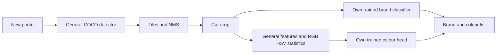

# Tashkent CarVision 1.2 — переносимый прототип

Владелец: **София Рахматулаева**. Обученный классификатор включён в пакет. Откройте фотографию и нажмите «Анализировать»: марка и цвет определяются автоматически, выбирать правильную марку не нужно. Windows 10/11 x64, CPU, без API, ключей, подписок и интернета при работе.

## Запуск и перенос

1. Полностью распакуйте TashkentCarVision-Portable.zip в папку с разрешением на запись.
2. Запустите CarVision.exe или Start CarVision.cmd. Python устанавливать не нужно.
3. «Анализ фото» → «Открыть фото» → «Анализировать». При необходимости выберите режим «Детальный».
4. Результаты видны в таблице и на фотографии. Выбор строки выделяет машину. «Копировать ответ» и «Экспортировать файлы» сохраняют результат.
5. На другой компьютер переносите всю папку CarVision, вместе с _internal и models. Один EXE без соседних файлов не работает.

Поддерживаются JPG/JPEG, PNG, BMP, WebP, EXIF-поворот. HEIC предварительно экспортируйте в JPEG. Ctrl+O — открыть фото, Ctrl+Enter — анализ. Результаты TXT/JSON/JPG автоматически сохраняются в outputs с уникальными именами.

## Что обучено и что измерено

Классификатор распознаёт **13 марок**: Audi, BMW, Chevrolet, Daewoo, Ford, Honda, Hyundai, Mercedes-Benz, Nissan, Tesla, Toyota, Volkswagen, Volvo.

Обучение: 3102 реальных машин, проверка при выборе модели: 683, 40 эпох. Источник — публичный Stanford Cars. Итоговый официальный test: **4026 фотографий, точность марки 84.6% на эталонных вырезках**. Это не точность всей уличной сцены. Матрица ошибок, покрытие при разных порогах, результаты по каждой марке и история обучения находятся в models/evaluation и models/public_brand_training.json.

Детектор — общий torchvision Faster R-CNN ResNet50 FPN v2 COCO (640/1024 px); марок он не определяет. Классификатор марки — MobileNetV3 Small с общей ImageNet-основой, объединением average/max pooling и собственной обученной головой на 13 марок. Готовый классификатор автомобильных марок не используется. Общие веса ImageNet/COCO явно разрешены владельцем 20.10.2026 и допускаются PDF задания.

Цвет — отдельная собственная обученная голова: общие ImageNet-признаки MobileNetV3, оригинальные пространственные статистики RGB/HSV и MLP. Обучение на 6210 изображениях VCoR с исходными метками; validation 1319; итоговая оценка — **91.6% на 1314 тестовых изображениях VCoR**. Тест не использовался для выбора checkpoint. Восемь классов white, black, grey, red, blue, green, brown, yellow; silver→grey, beige/gold/tan→brown, orange→yellow. Pink/purple исключены как не относящиеся к заданию. Точные SHA256 и одинаковые dHash-дубликаты удалены между частями. Идентичности машин в исходном наборе не доступны, поэтому split по автомобилям подтвердить нельзя. Исходная цветовая голова внутри brand-классификатора не используется; отдельный colour_model.pt содержит реально обученную цветовую голову. HSV-пороговый метод сохранён только как резерв при отсутствии отдельной модели.

## Ограничения, которые нужно учитывать

Китайские марки, Kia и Lada не входят в 13 обученных классов. Марка ниже порога уверенности выводится как unknown; неизвестная марка иногда может быть ошибочно названа известной. Начальный порог марки 0,5 выбран на dev-validation до итогового теста; при необходимости увеличьте его. Числовой «Порог марки» — порог уверенности, а не ручной выбор производителя. Softmax не является гарантией правильности.

Далёкие, перекрытые, вечерние машины, строгий боковой ракурс и локальные модели Chevrolet/Daewoo могут определяться хуже. COCO-категории car и truck включены для автомобилей, пикапов и фургонов; детектор может также предложить грузовик. Автобусы отдельной категории не включены. Цвет чувствителен к стеклу, теням, отражениям, фону и неполной рамке. Любая фотография принимается как вход, но правильное распознавание всех машин на любых фото не гарантируется.

Режимы: fast — весь кадр, balanced — кадр и перекрывающиеся фрагменты, detail — дополнительно отражённый кадр. Внутренние обрезанные рамки отбрасываются; NMS убирает повторения. Новые ракурсы обрабатываются моделью, а не таблицей заранее записанных ответов.

## Свои данные и обучение

Для работы поставляемого прототипа переобучение не нужно. Раздел «Учебная разметка» нужен для развития модели и выполнения требования собственных фотографий Ташкента. В нём ручные правильные марки/цвета обязательны как учебные ответы, но в анализ они не передаются.

Добавьте свои фото, обведите все различимые машины, сохраните марку по эмблеме, цвет, источник own и группу съёмки. Повторные кадры одной машины/сессии объединяйте одной группой. Можно вводить новые марки. Данные сохраняются в data/images и data/labels.jsonl. Проверка групп и SHA256 предотвращает разделение одинаковых снимков между train/validation. Нужны минимум две марки и независимые группы.

«Обучение» последовательно обучает собственные головы марок/цветов и двухклассовый детектор на вашей разметке с локальной общей основой. Старые модели сохраняются в models/backups. После переобучения повторно измерьте качество; маленький набор способен ухудшить модель. «Проверка качества» показывает опубликованные измерения прототипа, если личный набор пуст; иначе запускает оценку личного набора.

```powershell
.\CarVision.exe predict photo.jpg --mode balanced --output outputs
.\CarVision.exe audit --labels data/labels.jsonl
.\CarVision.exe train --labels data/labels.jsonl --output models --epochs 25 --detector-epochs 25
.\CarVision.exe evaluate --labels data/labels.jsonl --models models --output models/evaluation
```

## Фотографии и исходники

Отдельные реальные JPG Ташкента: samples/images/01.jpg … 06.jpg и архив Tashkent-JPG-Photos.zip рядом с проектом. Авторы, источники и лицензии: samples/sources.json. Эти шесть примеров не участвовали в обучении. BYD на примере не входит в поддерживаемые марки. Подборка PDF — вспомогательный материал, не итоговый отчёт.

Редактируемый код включён в source. Для разработки создайте Python 3.12 venv и установите requirements.txt. Для запуска GUI из папки source скопируйте соседнюю папку models в source/models; готовый EXE уже использует модели из своей папки. Для повторного получения публичного набора дополнительно requirements-data.txt; это требует интернета и места, но не требуется конечному пользователю EXE. Скрипты download_prototype_data.py → prepare_prototype_data.py → prepare_generic_detector.py --accurate → train_public_brand.py --imagenet --epochs 40 --size 160 → evaluate_public_prototype.py --split validation и затем --split test воспроизводят публичный эксперимент. Источники/численности: data/public_prototype/provenance.json; метки доступны в исходном проекте, исходные публичные изображения не включены в переносимый пакет.

Для воспроизведения цветовой модели после подготовки общих весов: python tools/download_colour_data.py, затем python tools/train_colour_model.py. Это загрузит только публичные фотографии и метки VCoR, а цветовая голова будет обучена локально. Исходный test не используется для выбора checkpoint; данные не включены в переносимый пакет. Итоговые цветовые показатели — models/colour_training.json, матрица — models/evaluation/colour_confusion.png.



Черновик отчёта с реальными данными: docs/CarVision_Prototype_Report.pdf (6 страниц). Он явно отмечен как прототип; GitHub и собственные фотографии пока отсутствуют.

## Соответствие заданию

Это работающий публичный прототип, **не окончательно выполненное задание**. Собственных учебных фотографий Ташкента пока 0; необходимая GitHub-ссылка ожидается. Нужны собственные данные, независимый тест телефоном до 120 секунд, подтверждение уникальности архитектуры среди команд, окончательный отчёт до 6 страниц с реальными вкладами/рефлексией/AI disclosure и публикация с тегом midterm. Подробная сверка — REQUIREMENTS_AUDIT.md. История коммитов Codex не выдаётся за историю работы студентов.
